<div align="center">

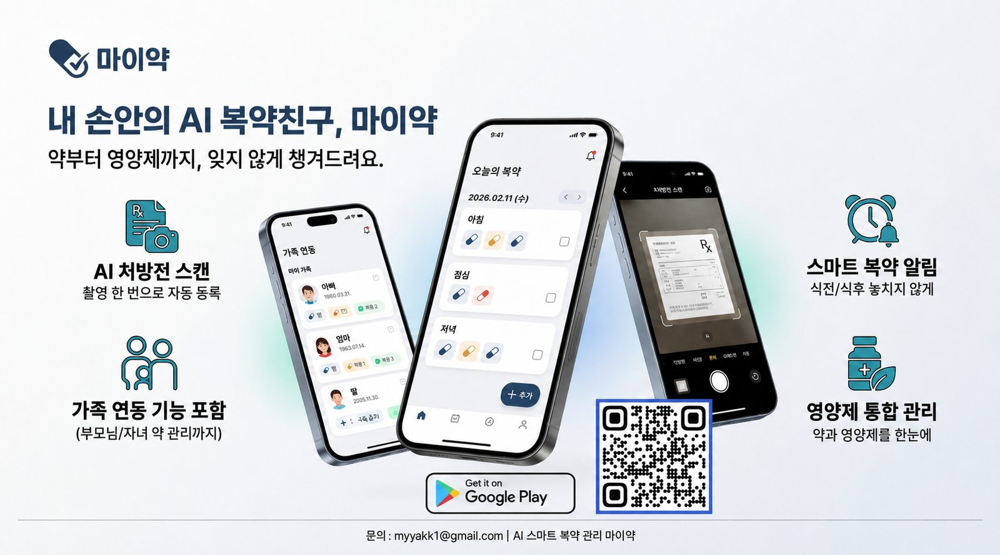

# 마이약 (MyYak)

**처방전을 촬영해 복약 정보를 등록하고,<br/>복약 기록과 증상 메모를 바탕으로 건강 리포트를 제공하는 복약 관리 앱**

[](https://play.google.com/store/apps/details?id=com.myyak.app&hl=ko)


-61DAFB?style=flat-square&logo=react&logoColor=black)


**개인 프로젝트** · 2026.01 ~ 운영 중 · Google Play 정식 출시

문서 기준: 2026-10-13

</div>

---

## 목차

1. [프로젝트 소개](#프로젝트-소개)
2. [주요 기능](#주요-기능)
3. [시스템 아키텍처](#시스템-아키텍처)
4. [기술적 도전과 해결](#기술적-도전과-해결)
5. [AI 모니터링과 자동 이슈 대응](#ai-모니터링과-자동-이슈-대응)
6. [검증 및 배포](#검증-및-배포)
7. [출시 및 운영](#출시-및-운영)
8. [앱 스크린샷](#앱-스크린샷)
9. [프로젝트 구성](#프로젝트-구성)

---

## 프로젝트 소개

고령화와 만성질환 증가로 여러 약을 장기간 복용하는 **다약제 복용자**가 늘고 있지만, 기존 복약 관리 서비스는 두 가지 한계가 있었습니다.

- **직접 입력과 단순 알림에 머물러** 디지털 취약 계층(어르신)이 접근하기 어렵고,
- 처방전 스캔도 **OCR + 정규식 파싱에 의존**해 병원·약국마다 다른 처방전/약봉투 양식에 대응하지 못했습니다.

마이약은 **OCR과 LLM 기반 비정형 문서 이해**로 처방전 입력을 돕습니다. 인식한 복약 정보를 확인·등록해 알림으로 연결하고, 쌓인 복약 기록과 증상 메모를 건강 리포트로 요약합니다. 운영 측면에서는 관리자 콘솔과 메일 승인 기반 장애 대응 시스템을 함께 구축했습니다.

| 혼자 사는 청년의 영양제 관리 | 부모님 약을 챙기는 보호자 |
|:---:|:---:|
| 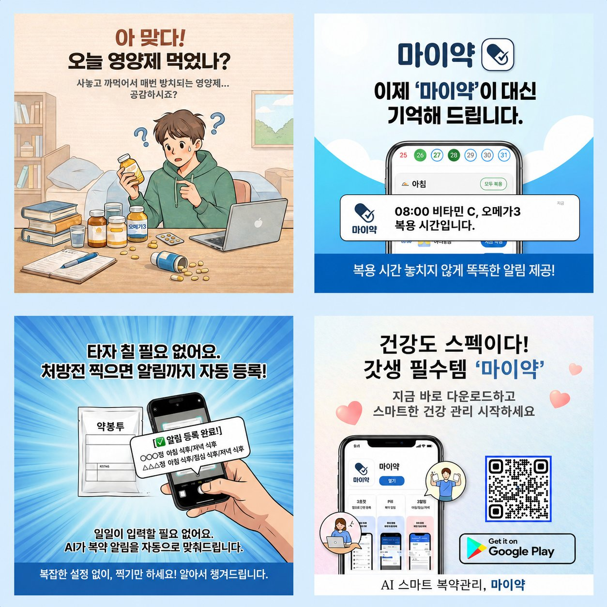 | 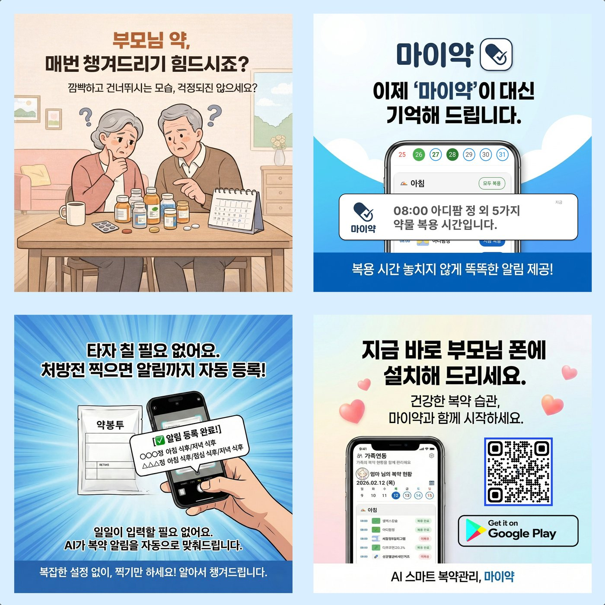 |

> 기획 단계에서 타겟 사용자를 "본인의 약/영양제를 관리하는 청년층"과 "부모님의 복약을 원격으로 챙기는 보호자"로 정의하고, 두 페르소나에 맞춰 **처방전 스캔 자동화**와 **가족 연동** 기능을 설계했습니다.

---

## 주요 기능

### 1. AI 처방전 스캔 — 인식 결과 확인부터 복약 알림 등록까지

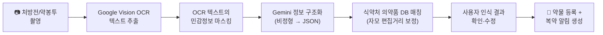

- **병원·약국마다 다른 양식**의 처방전/약봉투에서 추출한 텍스트를 LLM이 JSON으로 정규화
- OCR 오탈자를 **자모(초성·중성·종성) 편집 거리 알고리즘**으로 보정해 공공 의약품 DB와 매칭
- 사용자가 인식 결과와 용법을 확인·수정한 뒤 약물을 등록하면 **복약 알림을 함께 생성**

### 2. 복약 푸시 알림 & 가족 연동

- Firebase FCM 기반 복용 시간 푸시 알림 (다시 알림 10/30/60분 지원)
- **가족 연동**: 연동된 보호자에게도 알림 제공, 부모님의 복약 현황을 원격으로 확인
- 복용/건너뛰기 기록이 월간 달력에 자동 집계

### 3. AI 건강 리포트 — 복약 기록과 증상 메모 분석

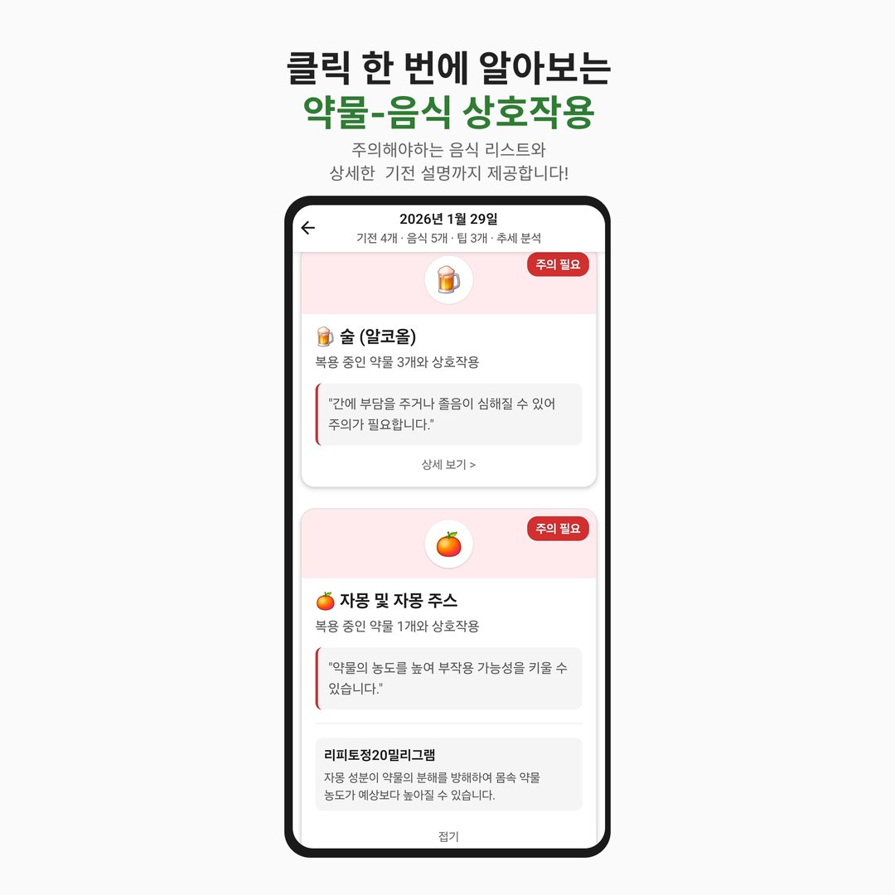

- 복용 중인 약물 목록 + 최근 30일 복약 기록 + 증상 메모를 LLM이 종합 분석
- 약물 정보와 분석 예시를 포함한 프롬프트로 복약 패턴·증상 메모의 연관성을 요약
- 리포트 구성: 약물 기전 분석 · **약물-음식 상호작용** · 영양제 상호작용 · 생활 팁 · 복약 패턴 추세
- 결과는 복약 관리를 위한 참고 정보로 제공하며, 진단 정확도나 질환 탐지 성능을 검증한 결과로 표현하지 않음

<br clear="right"/>

### 4. 약물 검색 — 식약처 공공데이터 기반

- 식품의약품안전처 e약은요 API 기반 약물 정보 제공 (효능, 용법, 주의사항)
- 약물 데이터 **인메모리 캐싱(Caffeine)** 으로 타이핑 중 실시간 연관 검색어 노출

### 5. 관리자 콘솔 — 로그 분석과 장애 대응 현황

- 클라우드 자원 및 가입자 현황 모니터링 대시보드
- 메일 인증과 Redis 세션 기반 관리자 로그인, 관리자 API 역할 검사
- 건강 분석용 Gemini 모델·폴백 설정을 UI에서 변경
- 에러 로그 대시보드 및 **대화형 AI 디버깅** (에러 로그를 LLM에게 분석 요청)
- **장애 대응 목록·상세 조회**: 자동 분석과 PR·메일 승인 흐름의 진행 상태 확인
- 관리자 UI는 이 서버의 `src/main/resources/static/admin/`에서 제공하는 HTML/CSS/JavaScript로 구성

---

## 시스템 아키텍처

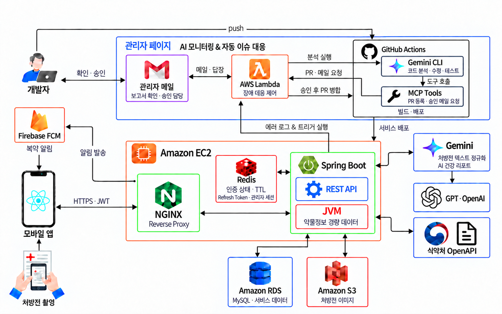

그림의 관리자 페이지 테두리는 모니터링·대응 기능을 묶은 표현입니다. Lambda와 GitHub Actions는 각각 별도 실행 환경에서 동작합니다. 자동 대응의 큐·상태 저장소·메일 인프라는 가독성을 위해 생략했습니다. FCM 알림 요청의 실제 발신 주체는 Spring Boot이며 NGINX는 요청 중계를 담당합니다.

처방전 운영 흐름은 **Google Vision OCR → 텍스트 마스킹 → Gemini 구조화**입니다. 그림의 GPT/OpenAI는 스캔 제공자로 선택할 수 있는 구현을 나타내며, Gemini 실패 시 자동으로 OpenAI로 전환한다는 뜻은 아닙니다. 건강 분석의 자동 폴백은 설정된 **Gemini 모델 사이**에서 수행합니다.

### 기술 스택

| 영역 | 기술 |
|------|------|
| **Backend** | Spring Boot 3.5.8, Java 21, Spring Data JPA/Redis, Spring Security + JWT |
| **Client** | React Native (Expo SDK 54), TypeScript, Expo Router, Zustand, Axios |
| **Data Store** | MySQL (AWS RDS), Redis 7.4 (임시 인증·Refresh Token·관리자 세션), Caffeine (검색 캐시) |
| **앱 AI 기능** | Google Vision OCR, Gemini API, OpenAI API (스캔 제공자 선택) |
| **장애 대응 에이전트** | Gemini CLI, Node.js, MCP TypeScript SDK, Zod, Docker |
| **장애 대응 제어** | AWS Lambda · SQS · DynamoDB · EventBridge · SES · S3 · Secrets Manager, GitHub App · OIDC |
| **Infra / CI·CD** | AWS EC2 · NGINX · S3, GitHub Actions, EAS Build |
| **Push 알림** | Firebase Admin SDK (FCM) |

---

## 기술적 도전과 해결

### 1. OCR·구조화·약물 매칭의 역할 분리

처방전 스캔을 **OCR → 텍스트 마스킹 → LLM 구조화 → 알고리즘 기반 DB 매칭**으로 나눴습니다. 건강 리포트의 모델 설정은 스캔 설정과 분리해 각 기능에 맞게 관리합니다.

| 구간 | 처리 방식 | 이유 |
|------|-----------|------|
| 텍스트 추출 | OCR (Google Vision) | 이미지에서 문자와 위치 추출 |
| 정보 구조화 | Gemini | 다양한 양식의 텍스트를 공통 JSON 구조로 변환 |
| 약물명 매칭 | 자모 편집거리 알고리즘 | LLM 없이 OCR 오탈자 보정 가능 |
| 건강 리포트 | 별도 설정한 Gemini 모델 | 복약 이력·증상 메모·약물 정보 종합 |

### 2. 외부 AI 연동 분리와 모델 폴백

건강 분석은 `LlmClient`와 `GeminiLlmAdapter`, OCR은 `OcrClient`와 제공자별 어댑터로 분리했습니다. 건강 분석에서 설정된 오류 조건을 만나면 다른 Gemini 모델로 재시도합니다. 관리자가 분석 모델·폴백 모델·활성 여부를 변경하면 설정 캐시 갱신 후 반영됩니다.

```
LlmClient → GeminiLlmAdapter → 분석 모델 / 폴백 모델
OcrClient → GoogleVisionOcrAdapter 또는 GeminiOcrAdapter
```

### 3. 기능별 프롬프트와 구조화된 응답

스캔 프롬프트에는 추출 필드와 JSON 예시를, 건강 리포트에는 분석 항목·복약 패턴·증상 메모 예시를 정의했습니다. 서버는 응답을 파싱해 기능별 DTO로 변환합니다. 프롬프트 지시와 응답 형식 검증만으로 내용의 의학적 정확성이 보장되는 것은 아닙니다.

### 4. 민감 정보 보호

- OCR로 추출한 텍스트의 민감정보를 마스킹한 뒤 구조화 LLM에 전달
- email, 전화번호, FCM 토큰은 **AES 필드 레벨 암호화** (JPA Converter)
- 가족 연동용 전화번호는 **해시(검색용) + AES 암호화(저장용)** 이중 처리
- 사용자 데이터 접근에서 소유권을 검사하고 관리자 역할 인가와 구분
- 임시 인증 상태·Refresh Token·관리자 세션을 Redis에서 관리하며 TTL·원자 소비·토큰 회전을 적용

## AI 모니터링과 자동 이슈 대응

수동 로그 분석에 더해 **오류 수집 → 코드 수정·검증 → PR → 메일 승인 → 병합·배포** 흐름을 구현했습니다. 별도 상시 EC2를 추가하지 않고, 긴 분석은 GitHub Actions에서 실행하며 Lambda는 상태와 외부 연동을 조정합니다. 작업용 에이전트·제어 계층은 별도 비공개 저장소에서 관리합니다.

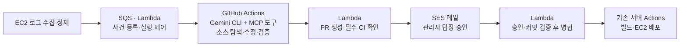

### Gemini CLI와 MCP 도구의 역할

Gemini CLI가 모델 호출과 도구 실행 루프를 담당하고, 직접 구현한 Node.js MCP 서버가 stdio로 도구를 제공합니다. 에이전트는 배포 커밋 기준으로 준비된 소스를 필요한 만큼 조회합니다. **MCP SDK는 도구 연결 규약을 구현하는 라이브러리**이고, 수정 범위와 실행 조건은 도구 코드에서 강제합니다.

| 도구 | 역할 |
|------|------|
| `get_incident` | 사건과 배포 커밋·조회 가능한 소스 확인 |
| `read_source` / `search_source` | 허용된 파일 읽기·검색 |
| `edit_source` | 허용된 업무 코드 수정·회귀 테스트 추가 |
| `verify_fix` | 원본 코드의 실패와 수정 코드의 성공, 오프라인 테스트 검증 |
| `create_pull_request` | 현재 검증 증거와 일치하는 패치 제출 |
| `request_approval_email` | 해당 PR의 승인 메일 발송 요청 |
| `report_manual_required` | 검증된 수정이 어려우면 수동 조치 필요 상태로 종료 |

PR 등록·메일 도구는 Lambda에 **비동기 요청을 접수**합니다. 실제 메일은 PR의 필수 CI 통과 후 SES가 발송하며, 모델의 완료 문장을 실행 성공의 증거로 사용하지 않습니다. 에이전트에는 승인·병합·운영 배포 도구를 제공하지 않습니다.

### 검증과 승인 경계

- 새 회귀 테스트가 원본 코드에서 실패하고 수정본에서 통과해야 PR을 제출할 수 있습니다. 이후 코드가 바뀌면 이전 검증 증거를 무효화합니다.
- 테스트는 네트워크·운영 자격 증명·Docker 소켓을 제공하지 않는 컨테이너에서 실행합니다.
- 제출 내용을 고정하고 사건 상태·작업 점유·중복 요청을 제어합니다. 메일 전달까지 포함한 종단 간 정확히 한 번 처리를 보장한다는 의미는 아닙니다.
- 관리자는 원본 메일에 답장합니다. 제어 계층이 발신·메일 연결·만료·일회성 승인과 정확한 PR 커밋을 확인한 뒤 병합합니다.
- 실행 시간·도구 호출·수정 범위·재시도·일일 실행 수를 제한합니다. 현재 토큰 사용량은 미수집이며 실행 제한이 금액 상한을 보장하지는 않습니다.

**현재 검증 상태:** CLI/MCP 연결, 도구 계약, 가짜 모델을 통한 호출 시나리오, 실제 Docker 회귀 검증과 Lambda 배포를 확인했습니다. 기존 메일 흐름에서는 실제 반려 답장 왕복을 확인했습니다. 새 CLI/MCP 버전의 실제 장애 수정부터 메일 승인·병합·재배포까지 이어지는 전체 시나리오는 별도 검증이 남아 있습니다. 장애 대응 시간 단축이나 무인 복구 성공률을 측정된 성과로 제시하지 않습니다.

## 검증 및 배포

| 구분 | 현재 흐름 |
|------|-----------|
| 서버 PR 검증 | 임시 MySQL·Redis로 `checkServer`, 관리자 JavaScript 구문 검사, 운영 설정 없는 `bootJar` |
| 비밀정보 검사 | PR·main 변경 커밋에 대한 Secret scan |
| 서버 배포 | main push → GitHub Actions → `bootJar` → EC2 서비스 갱신 |
| 장애 수정 승인 | 회귀 검증·필수 CI → 메일 승인 → 승인한 커밋 병합 → 기존 서버 배포 |
| 앱 배포 | 별도 클라이언트 저장소의 GitHub Actions · EAS Build · Google Play 제출 |

서버 배포 workflow의 `bootJar` 자체는 테스트를 실행하지 않으므로 PR 검증과 구분합니다. 운영 자격 증명·전체 설정·원본 장애 로그·관리자 수신 주소는 공개 문서에 포함하지 않습니다.

---

## 출시 및 운영

- **Google Play 정식 출시** — [마이약: AI 처방약/영양제 알림, 건강상태 자동 분석](https://play.google.com/store/apps/details?id=com.myyak.app&hl=ko)
- 서비스 운영 중 (2026.01 ~ ), 관리자 로그 조회와 장애 대응 현황 제공
- 기획 → 디자인 → 개발 → 출시 → 운영/유지보수까지 **전 사이클 1인 수행**
- MCP 도구 기반 코드 수정·검증과 메일 승인 기반 운영 흐름 구현

---

## 앱 스크린샷

| 홈 — 오늘의 복약 | 처방전 스캔 | 약물 상세 |
|:---:|:---:|:---:|
| 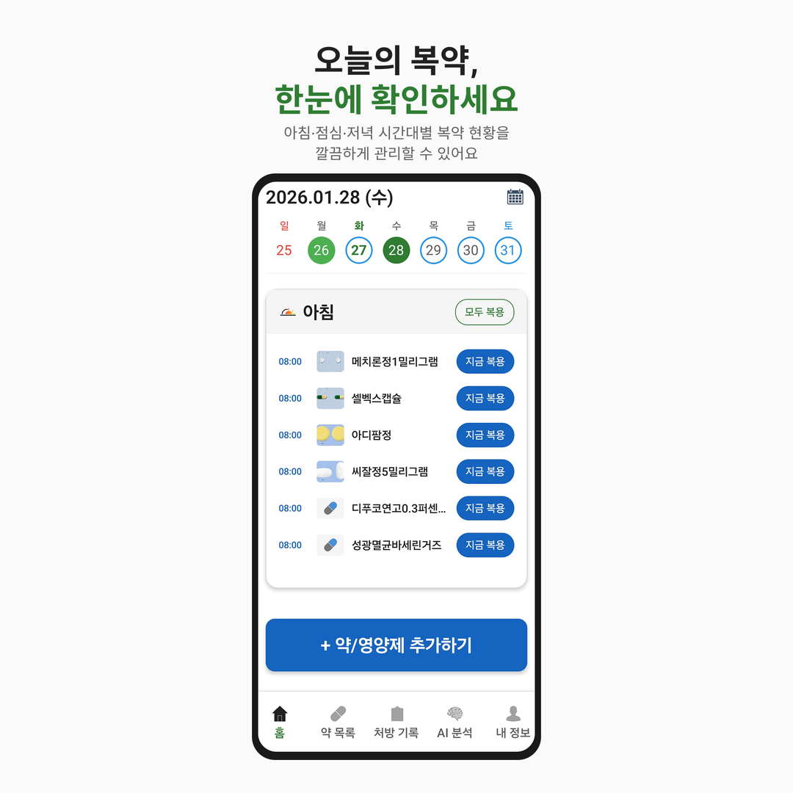 | 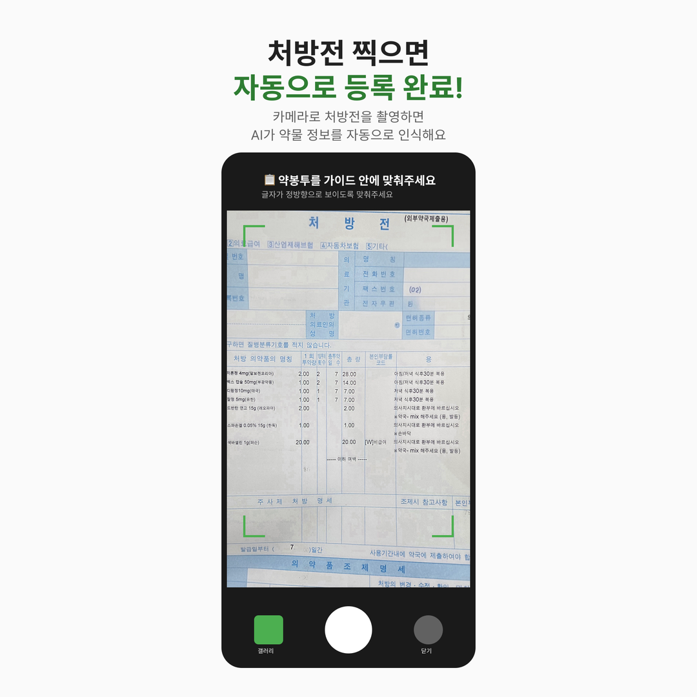 | 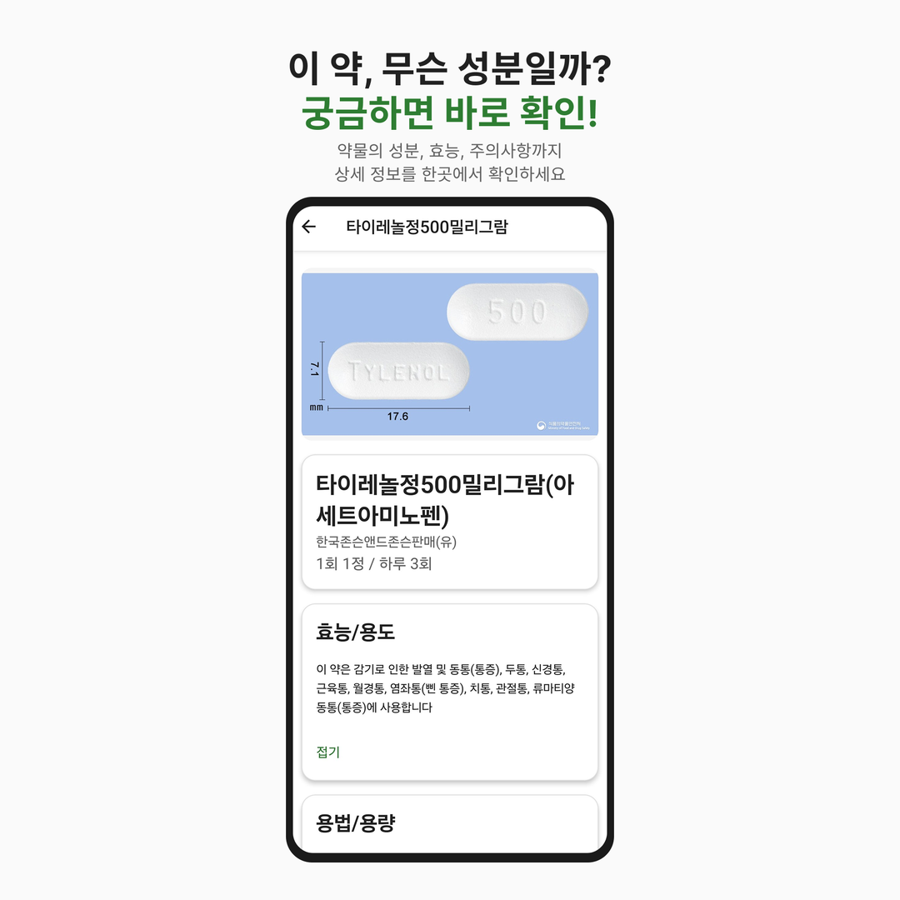 |

| AI 건강 리포트 — 요약 | AI 건강 리포트 — 추세 분석 |
|:---:|:---:|
| 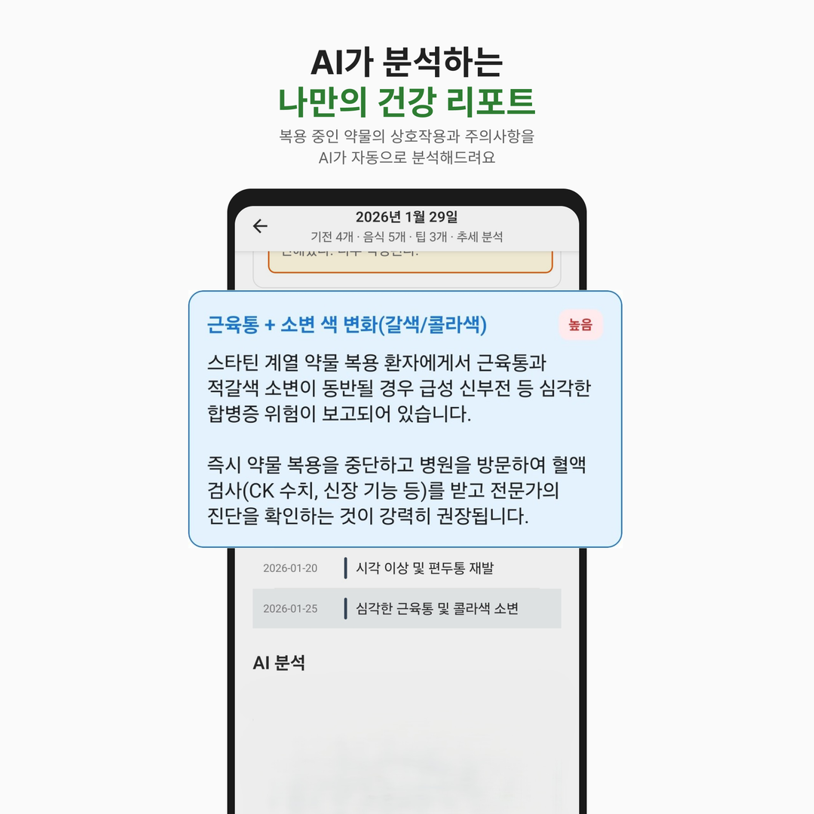 | 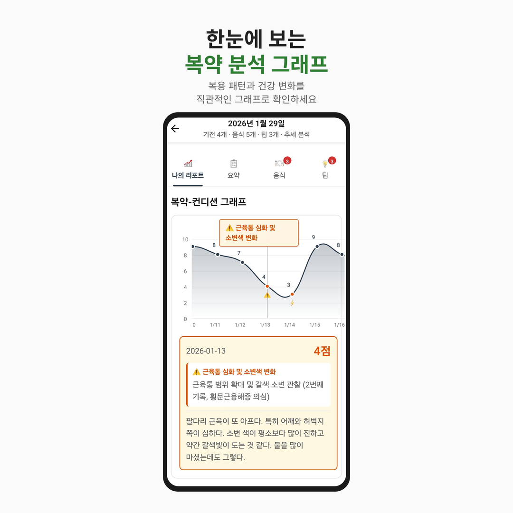 |

| 가족 연동 — 내 화면 | 가족 연동 — 가족 화면 |
|:---:|:---:|
| 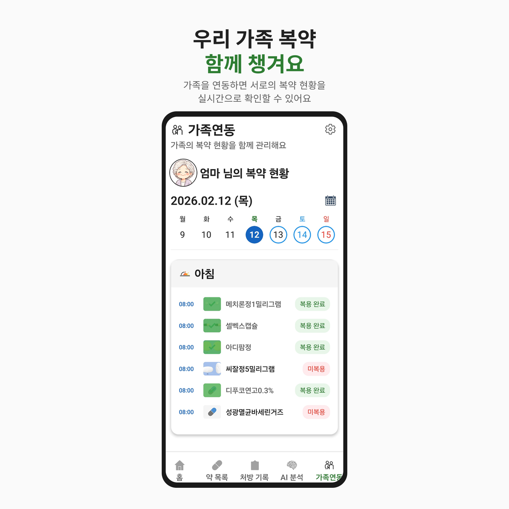 | 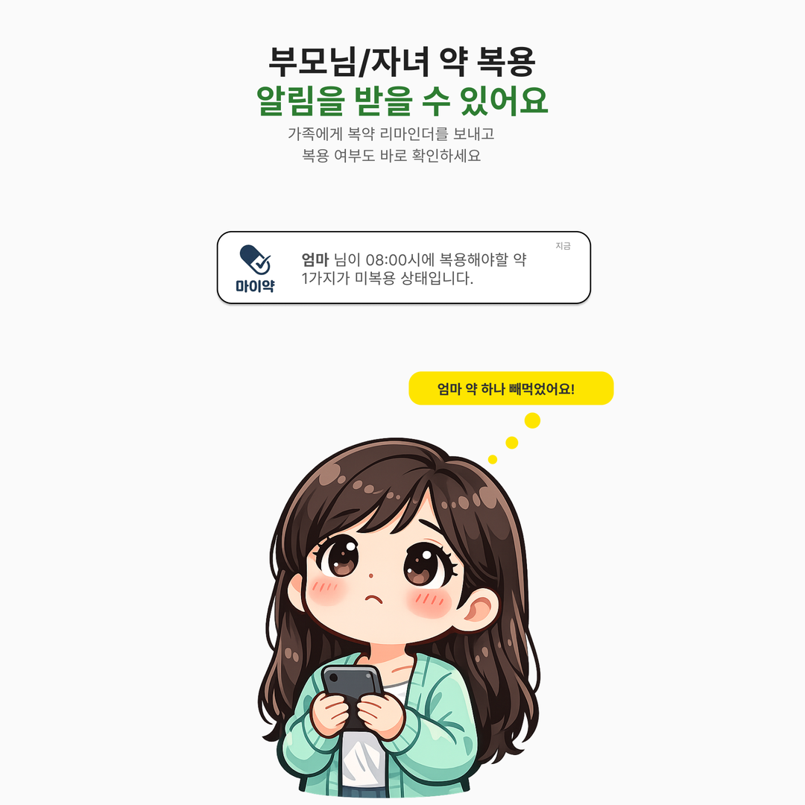 |

<div align="center">
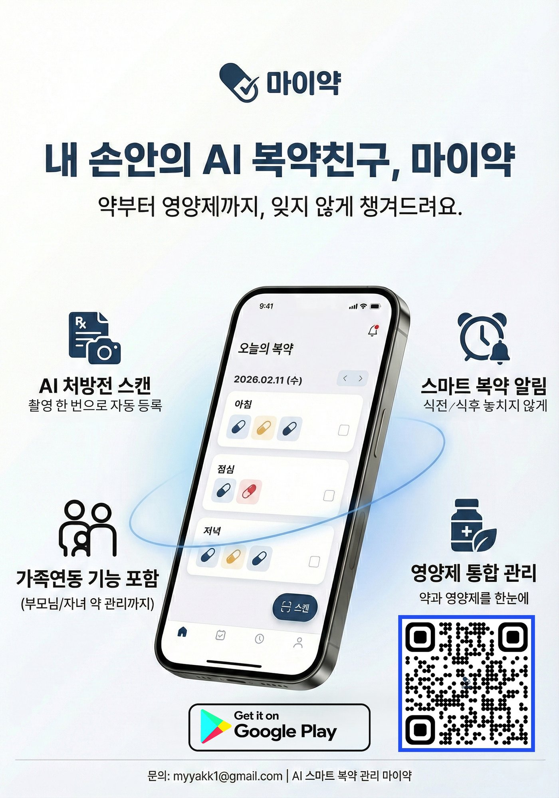

**지금 바로 사용해 보세요 →** [Google Play에서 다운로드](https://play.google.com/store/apps/details?id=com.myyak.app&hl=ko)
</div>

---

## 프로젝트 구성

| 리포지토리 | 설명 |
|-----------|------|
| [BackEnd-SpringBoot](https://github.com/myYack-team/BackEnd-SpringBoot) (현재 리포) | Spring Boot API 서버, 관리자 UI, 장애 현황 조회 |
| [Client-ReactNative](https://github.com/myYack-team/Client-ReactNative) | React Native (Expo) 모바일 앱 |
| [myYak-website](https://github.com/myYack-team/myYak-website) | 서비스 소개·개인정보·약관·탈퇴 안내 정적 사이트 |
| 별도 비공개 작업 저장소 | Gemini CLI/MCP 도구, 장애 제어 계층과 분석 워크플로 |

**백엔드 상세 문서**: [백엔드 가이드](docs/BACKEND_GUIDE.md), [Redis 임시 인증 저장소](docs/REDIS_AUTH_OPERATIONS.md), [Refresh Token Redis 운영](docs/REFRESH_TOKEN_REDIS_OPERATIONS.md), [일일 앱 방문자 통계](docs/DAILY_APP_VISITORS.md). 상세 문서는 각 문서의 기준 시점과 함께 확인합니다.

**문의**: [GitHub Issues](https://github.com/myYack-team/BackEnd-SpringBoot/issues)
